  

  
  
  

---

I build software for businesses, from the first product decisions to the infrastructure that keeps it running. I enjoy working where engineering meets operations: understanding how a business works, deciding what to build, and taking responsibility for delivering it.

I'm currently **CTO at Agro en Punta** and **co-founder and founding engineer at Cameltrace**. Across both roles, my work spans technical strategy, hands-on development, and translating business needs into software people use.

## 🚀 What I'm building

### 🌾 Agro en Punta - CTO

Agro en Punta is an agribusiness events and media company. Its flagship event brought together **11,000+ business attendees and 200+ exhibitors in its 2026 edition**.

I lead technology for a 20-person organization, covering architecture, infrastructure, tooling, and vendor decisions. I also work on the event, exhibitor, and attendee platform, connecting the needs of commercial, marketing, and operations teams with the systems that support their work.

     

### 🐪 Cameltrace - Co-founder & Founding Engineer

Cameltrace is a **B2B event-management SaaS**, built to support CRM workflows, commercial processes, and coordination across teams.

As founding engineer, I've worked on the product from the ground up, including scoping, full-stack development, deployment, and self-hosted infrastructure.

   

## 🧪 Other projects

**🕵️ Impersonation Detector** · Proof of concept  
A system for identifying fake social media accounts that repost an influencer's content. It explores reverse image search and facial recognition rather than relying on account-name matching.  
*Python, FastAPI, InsightFace, pgvector, Playwright, React.*

**🔒 [WhatsApp Privacy Blur](https://github.com/Franco-BP/whatsapp-privacy-blur)** · Chrome extension  
Blurs chats, names, and media on WhatsApp Web until you hover over them.  
*JavaScript, Chrome Extensions Manifest V3.*

## 🧭 How I work

- **Own the full picture.** I work across architecture, product development, infrastructure, and the decisions that connect them.
- **Build from real needs.** I like understanding the people and processes behind a problem before choosing a technical solution.
- **Stay hands-on.** I enjoy designing systems as much as implementing and deploying them.
- **Explore applied AI.** My work includes computer vision, face embeddings, vector search, and LLM integrations aimed at practical use cases.

## 🛠️ Technologies

| Area | Tools and technologies |
| --- | --- |
| Languages |     |
| Frontend |     |
| Backend |     |
| Data |     |
| Infrastructure |      |

*Also studied C# in an academic setting.*

## 🤝 Connect

[LinkedIn](https://linkedin.com/in/francobascialla) · Punta del Este, Uruguay  
Italian and Uruguayan citizen · Spanish, English (C2), Portuguese

Most of my production work is in private company repositories. I'm happy to discuss the architecture, trade-offs, and engineering decisions behind it.

  

